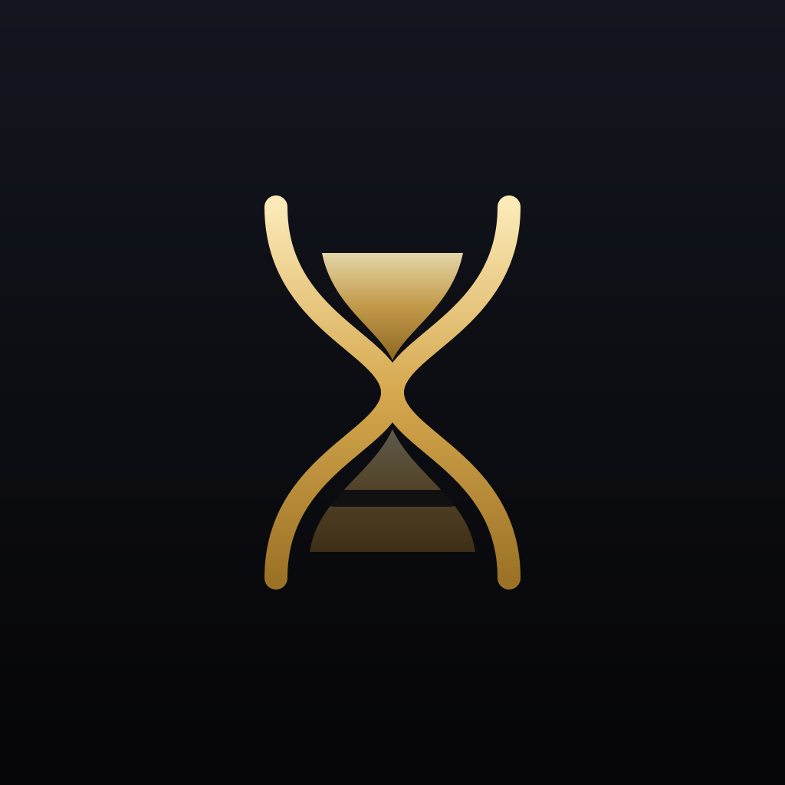

# AnyTimer



عدّادات تنازلية بلا حدود لأي مناسبة، لنظام iOS 17 فأحدث (SwiftUI وWidgetKit). بلا حسابات أو خادم أو إعلانات أو تحليلات. التنزيل من [Releases](https://github.com/Kaido1070/GTA-VI-timer/releases).

## المزايا

- عدد غير محدود من العدّادات: إضافة، تعديل، تكرار، حذف، وإعادة ترتيب.
- لكل عدّاد: الاسم، التاريخ والوقت، صورة من الألبوم أو بدون، لون الخلفية والنص والأرقام، نوع الخط (18 خطًا)، تعتيم الصورة، وتذكيرات اختيارية.
- الودجت لكل عدّاد: مكان الصورة (بجانب النص، خلفية كاملة، بدون)، المحاذاة، وإظهار الاسم والتاريخ والساعات والدقائق والثواني الحية. كل ودجت يختار عدّاده: اضغط مطولًا > تحرير الأداة.
- مظهر التطبيق: لون التطبيق والخلفية وحجم البطاقات.
- ودجت الشاشة الرئيسية (صغير، متوسط، كبير) وشاشة القفل (مستطيل، دائري، سطر)، Siri والاختصارات، النشاط المباشر في آخر 8 ساعات، وزر مركز التحكم.
- الترقية من GTA VI Timer 1.x تحافظ على العدّاد السابق تلقائيًا (نفس معرّف الحزمة وApp Group).

**الودجت يحتاج App Group** (`group.com.kaido1070.gtavitimer`) في توقيع التطبيق والامتداد معًا. بدونها تعمل العدّادات داخل التطبيق، ويعرض الودجت «Open the app to add a countdown» لأنه لا يستطيع قراءة بيانات التطبيق.

## البناء على macOS

```sh
brew install xcodegen
xcodegen generate
open GTAVITimer.xcodeproj
```

المصدر الموثوق لإعدادات المشروع `project.yml`. المشروع المولّد مرفق أيضًا بعد نجاح البناء. اختر scheme `GTAVITimer` ثم iPhone Simulator، وشغّل Product > Test. للبناء غير الموقّع للأجهزة:

```sh
bash Scripts/build-unsigned.sh
```

ينتج `build/AnyTimer-unsigned.ipa` بعد التأكد من وجود `PlugIns/TimerWidget.appex` والملف التنفيذي. **IPA غير الموقّعة لا تُثبّت مباشرة**. مسار GitHub Actions يدوي من Actions > iOS manual build > Run workflow؛ ينفذ اختبارات المحاكي، بناء الجهاز، ويحفظ الأدلة والمشروع وIPA لمدة 14 يومًا. لا يحتاج شهادات ولا يضعها في السجلات. حالة التنفيذ الفعلية وروابط تحميل IPA والأدلة موثقة في [VERIFICATION.md](VERIFICATION.md). نجح بناء IPA غير موقعة واختبارات المحاكي. خيار `rendering` في workflow يعيد اختبار العرض وحده دون إعادة بناء نسخة الأجهزة.

## التوقيع والتثبيت

1. للمشاركة الكاملة، على Mac مع Xcode وحساب Apple Developer يدعم App Groups، اختر Team نفسه للتطبيق `GTAVITimer` والامتداد `TimerWidget`.
2. سجّل معرفين فريدين للتطبيق والامتداد (الافتراضيان `com.kaido1070.gtavitimer` و`com.kaido1070.gtavitimer.widget`). حدّثهما في إعدادات المشروع إذا لزم.
3. أنشئ `group.com.kaido1070.gtavitimer` وفعّل المجموعة نفسها لكلا App IDs وكلا provisioning profiles. عند تغييرها حدّث `APP_GROUP_IDENTIFIER` لكلا الهدفين. عند غياب App Group في 1.1 يُفعّل حفظ محلي داخل التطبيق مع تنبيه إلى عدم مشاركة تخصيصاته مع الودجت؛ أما فشل الكتابة الفعلي فيظهر كخطأ ولا يُدّعى نجاح الحفظ.
4. وصّل iPhone، فعّل Developer Mode، اختر الجهاز، وشغّل Run. أو Archive ثم Export باستخدام Development/Ad Hoc وملفات توقيع تشمل الجهاز. وقّع الامتداد المضمّن والتطبيق مع صلاحيات المجموعة؛ إعادة توقيع التطبيق وحده غير كافية. ملفات المصدر وIPA غير الموقعة ليست تطبيقًا جاهزًا للتثبيت.
5. افتح التطبيق مرة. لإضافة ودجت الرئيسية: اضغط مطولًا على الشاشة > تحرير > إضافة أداة > AnyTimer واختر الصغير أو المتوسط أو الكبير.
6. لشاشة القفل: اضغط مطولًا على شاشة القفل > تخصيص > شاشة القفل > منطقة الأدوات تحت الساعة > AnyTimer واختر الودجت المستطيل.

## سلوك العد

- الأيام = الجزء الصحيح من الثواني الفعلية المتبقية ÷ 86400. الساعات والدقائق والثواني في الودجت يعدّها النظام حيًّا؛ الودجت يُعاد تحميله عند حدود الأيام. التاريخ والوقت يُحفظان كوقت محلي ويُعاد تفسيرهما عند تغيّر المنطقة الزمنية.
- الصور تُستورد كنسخة JPEG مصغرة إلى 1600 بكسل دون صلاحية وصول شامل للألبوم، وتُحذف عند عدم استخدامها.
- شاشة القفل تُعرض بلون موحّد (vibrant) حسب iOS؛ الألوان المخصصة تظهر في ودجت الشاشة الرئيسية والتطبيق.
